# Severidade não é exploração: a nota CVSS prioriza bem as correções de segurança?

**MVP (Minimum Viable Product): pipeline de dados em nuvem**
Universidade de Brasília (UnB), Departamento de Engenharia de Produção
Professor: André Luiz Marques Serrano
**Autor:** João Pedro Ferreira Bitencourt (matrícula 211068047)
**Plataforma:** Databricks Free Edition (Unity Catalog, Delta Lake, computação serverless) ([evidência 1](evidencias/01_databricks_free_edition.png))

> This product uses the NVD API but is not endorsed or certified by the NVD.

| Seção | Conteúdo |
|---|---|
| [1. Objetivo](#1-objetivo) | Problema, hipótese, perguntas de negócio e viabilidade |
| [2. Arquitetura e reprodução](#2-arquitetura-do-pipeline-e-reprodução) | Visão geral do pipeline e passo a passo para rodar |
| [3. Busca e coleta](#3-busca-e-coleta) | Fontes, licenças, data, volume e formato |
| [4. Modelagem](#4-modelagem) | Esquema estrela, catálogo de dados e regras de transformação |
| [5. Carga](#5-carga-etl) | Pipeline de ETL e validações |
| [6. Análise](#6-análise) | Qualidade dos dados, respostas às perguntas e discussão |
| [7. Autoavaliação](#7-autoavaliação) | Objetivos atingidos, limitações e próximos passos |
| [8. Ética e licenças](#8-ética-licenças-e-proteção-de-dados) | Licenças, LGPD e uso dos dados |

---

## 1. Objetivo

### 1.1 Problema

Toda vulnerabilidade de software divulgada publicamente recebe um identificador **CVE** (*Common Vulnerabilities and Exposures*). Só em 2026, até o fim de setembro, foram publicadas mais de 73 mil. Nenhuma equipe de TI corrige tudo, então é preciso **priorizar**. A prática mais comum é ordenar as correções pela nota **CVSS** (*Common Vulnerability Scoring System*), de 0 a 10, que mede a gravidade *potencial* de cada falha.

Gravidade potencial, porém, não é o mesmo que risco real. O que importa para quem defende uma rede é se a falha **está sendo explorada por atacantes**. A agência americana de segurança cibernética (CISA) mantém o catálogo **KEV** (*Known Exploited Vulnerabilities*), com as CVEs cuja exploração em ataques reais foi comprovada.

Este MVP cruza as duas bases (o **NVD**, banco de vulnerabilidades do NIST com notas CVSS e tipos de falha, e o **KEV** da CISA) para avaliar se a nota CVSS é um bom critério de priorização.

**Decisão apoiada:** como priorizar a correção de vulnerabilidades quando a capacidade da equipe não permite corrigir todas. Em termos de Engenharia de Produção, é um problema de alocação de capacidade escassa sob risco.

### 1.2 Hipótese

> A severidade CVSS, sozinha, é um critério fraco para prever quais vulnerabilidades serão exploradas: ela concentra esforço em muitas falhas que nunca são exploradas e deixa de fora parte relevante das que são. O tempo até a exploração e o tipo de falha ou fornecedor também importam.

**Como a hipótese é verificada:** pela taxa de entrada no KEV em cada faixa de severidade (precisão da priorização) e pela parcela do KEV coberta por cada estratégia de priorização em relação ao esforço exigido (cobertura x esforço).

### 1.3 Perguntas de negócio

| # | Pergunta | Decisão que informa |
|---|---|---|
| **P1** | Que proporção das CVEs publicadas chega ao KEV e como essa proporção varia por faixa de severidade CVSS (baixa, média, alta, crítica)? | Se priorizar só pela faixa CVSS cobre as vulnerabilidades realmente exploradas, e com que esforço |
| **P2** | Quanto tempo, em mediana, passa entre a publicação de uma CVE e sua entrada no KEV, e esse prazo mudou ao longo dos anos? | Qual a janela de tempo disponível para corrigir antes da exploração |
| **P3** | As CVEs do KEV associadas a campanhas de ransomware têm um perfil distinto das demais (severidade, tipo de falha, fornecedor)? | Que classes de falha e de produto priorizar quando a principal ameaça é ransomware |

No planejamento inicial foram consideradas cinco perguntas. Antes de iniciar a busca, o escopo foi reduzido a estas três. As duas descartadas (ranking de tipos de falha entre críticas e exploradas e participação de cada fornecedor no total de CVEs) estão registradas como trabalhos futuros na [autoavaliação](#7-autoavaliação).

### 1.4 Viabilidade

| Dimensão | Evidência neste MVP |
|---|---|
| **Técnica** | Pipeline completo (coleta, modelagem, carga e análise) executado no Databricks, com dados persistidos em Volume e tabelas Delta do Unity Catalog ([seção 5](#5-carga-etl)) |
| **Financeira** | Custo de infraestrutura zero: Databricks Free Edition e APIs públicas e gratuitas. Uma execução completa leva cerca de 40 minutos, quase todo esse tempo na coleta do NVD, limitada pela taxa de requisições da API sem chave. A manutenção contínua seria incremental e barata ([seção 7](#7-autoavaliação)) |
| **Desejabilidade** | As três perguntas foram respondidas com dados e geram recomendações práticas de priorização ([seção 6.5](#65-discussão-geral)) |

---

## 2. Arquitetura do pipeline e reprodução

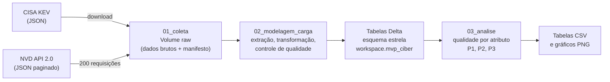

### 2.1 Estrutura do repositório

| Caminho | Conteúdo |
|---|---|
| `README.md` | Este documento |
| `notebooks/01_coleta.py` | Coleta do KEV e do NVD, gravação no Volume e manifesto da coleta |
| `notebooks/02_modelagem_carga.py` | ETL: extração, regras de transformação, esquema estrela, controle de qualidade, carga e catálogo |
| `notebooks/03_analise.py` | Qualidade dos dados por atributo e respostas às perguntas |
| `scripts/diagnostico_nvd.py` | Diagnóstico exploratório dos dados brutos, que orientou as regras de transformação |
| `catalogo/` | Catálogo de dados (`.md` e `.csv`) |
| `evidencias/` | Capturas de tela da execução e gráficos dos resultados |
| `LICENSE` | Licença do código e registro das licenças dos dados |

Os notebooks estão no formato *source* do Databricks (`.py` com marcadores `# COMMAND ----------`) e podem ser importados diretamente no Workspace.

### 2.2 Como reproduzir

1. Crie uma conta no [Databricks Free Edition](https://www.databricks.com/learn/free-edition).
2. Em **Workspace**, use **Import** para trazer os três arquivos da pasta `notebooks/`.
3. Rode `01_coleta` com **Run all**. O notebook cria o schema `workspace.mvp_ciber` e o Volume `raw`. Sem chave da API do NVD, a coleta leva cerca de 35 minutos. Com uma [chave gratuita](https://nvd.nist.gov/developers/request-an-api-key), informada no campo do topo do notebook, o tempo cai bastante. Se a execução for interrompida, basta rodar de novo: as páginas já baixadas são puladas.
4. Rode `02_modelagem_carga`, que leva alguns minutos e grava as 8 tabelas.
5. Rode `03_analise`, que leva 1 a 2 minutos e salva tabelas e gráficos em `/Volumes/workspace/mvp_ciber/raw/resultados`.

Os dados de uma nova execução serão mais recentes que os deste relatório, pois as duas bases são atualizadas diariamente.

---

## 3. Busca e coleta

### 3.1 Fontes de dados

| Fonte | Mantenedor | O que fornece | Acesso |
|---|---|---|---|
| **NVD** (*National Vulnerability Database*) | NIST, governo dos EUA | Todas as CVEs publicadas, com data de publicação, notas CVSS (v2.0, v3.0, v3.1 e v4.0), tipos de falha (CWE) e status de análise | [API REST 2.0](https://nvd.nist.gov/developers/vulnerabilities), paginada, até 2.000 CVEs por requisição |
| **KEV** (*Known Exploited Vulnerabilities*) | CISA, governo dos EUA | CVEs com exploração comprovada, com data de inclusão, fornecedor, produto e indicador de uso em ransomware | [Arquivo JSON](https://www.cisa.gov/known-exploited-vulnerabilities-catalog) único |

As duas bases foram escolhidas **depois** da definição das perguntas, por serem as fontes oficiais e abertas que, juntas, permitem respondê-las: o NVD fornece o universo de CVEs e a severidade; o KEV fornece o desfecho (explorada ou não). A chave de ligação entre elas é o identificador da CVE.

**Siglas usadas:** CVSS (*Common Vulnerability Scoring System*, nota de gravidade de 0 a 10) e CWE (*Common Weakness Enumeration*, classificação do tipo de falha, como injeção de SQL ou estouro de memória).

### 3.2 Coleta

A coleta é feita pelo notebook [`01_coleta`](notebooks/01_coleta.py), que roda inteiramente no Databricks. Antes, foi verificado que a computação serverless da Free Edition alcança as duas fontes ([evidência 2](evidencias/02_teste_acesso_apis.png)).

| Item | KEV | NVD |
|---|---|---|
| Data da coleta | 28/09/2026 | 28/09/2026, início às 21:22 UTC (*timestamp* da base: `2026-09-28T21:22:48.811`) |
| Versão | Catálogo `2026.09.27` | Situação da base no momento da coleta |
| Volume | 1 arquivo, 1.757.262 bytes, **1.728 registros** | 200 arquivos (páginas), cerca de 200 MB compactados, **398.833 CVEs** |
| Formato original | JSON | JSON (cada página gravada como `.json.gz`, sem alteração do conteúdo) |
| Integridade | SHA-256 `164f2f100c3a2a810745500f49a8dd9041d59f9542c0ac1316d71578f25cb80b` | Páginas gravadas = páginas esperadas (200 = 200) |
| Local na nuvem | `/Volumes/workspace/mvp_ciber/raw/kev/` | `/Volumes/workspace/mvp_ciber/raw/nvd/` |

**Decisões da coleta:**
- **Respeito ao limite da API do NVD.** Sem chave, a API aceita 5 requisições a cada 30 segundos, e o notebook espera 6,5 s entre páginas. Em caso de resposta 403, 429 ou 503, ele aguarda e tenta de novo, até 6 vezes.
- **Retomada.** Cada página é gravada em arquivo temporário e renomeada ao final, o que impede páginas corrompidas. Uma nova execução pula as páginas existentes.
- **Manifesto.** Um arquivo `coleta_manifesto.json` registra data, volume, formato e hash dos arquivos ([evidência 6](evidencias/06_manifesto_coleta.png)).
- **Execuções.** As 200 páginas do NVD foram baixadas na primeira execução. Uma interrupção da sessão, causada pela suspensão do computador, exigiu rodar o notebook de novo ([evidência 14](evidencias/14_falha_retomada_coleta.png)). A segunda execução apenas confirmou as páginas existentes, baixou o KEV de novo (com hash idêntico) e regravou o manifesto, por isso ele registra 22:18 UTC como horário.

**Evidências da coleta:**

| | |
|---|---|
| Coleta do KEV, com volume, versão e hash | 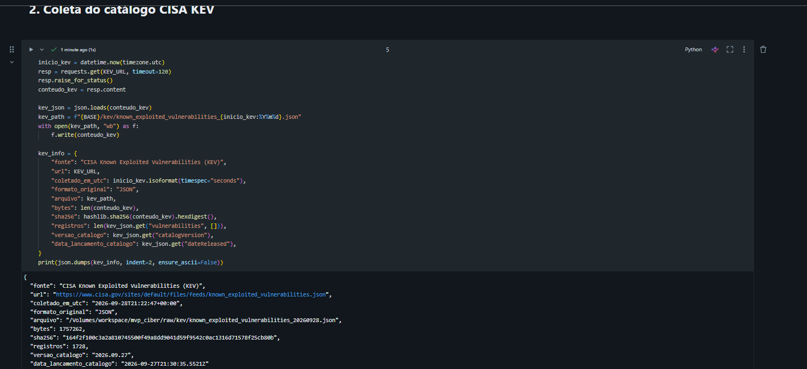 |
| Coleta do NVD em andamento | 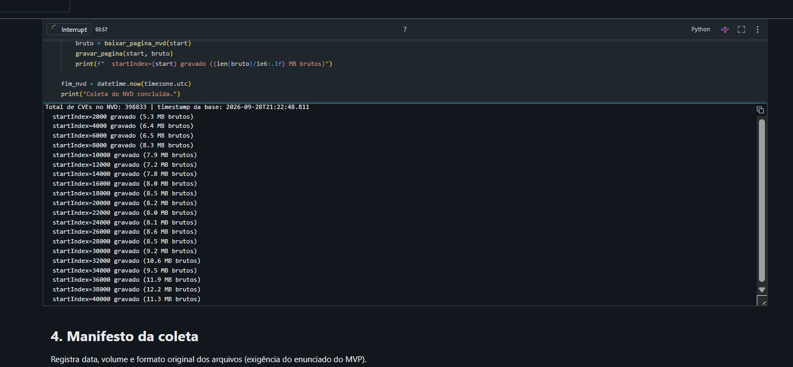 |
| Coleta do NVD concluída: 398.833 CVEs | 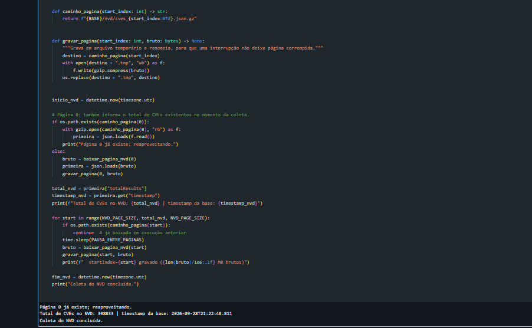 |
| Manifesto da coleta | 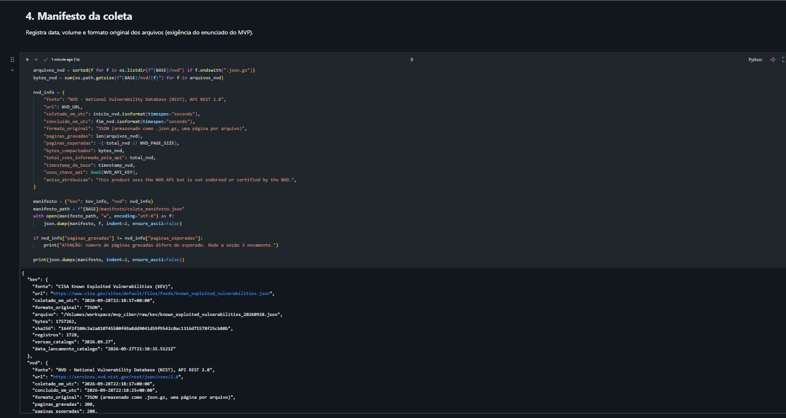 |
| 200 arquivos do NVD no Volume | 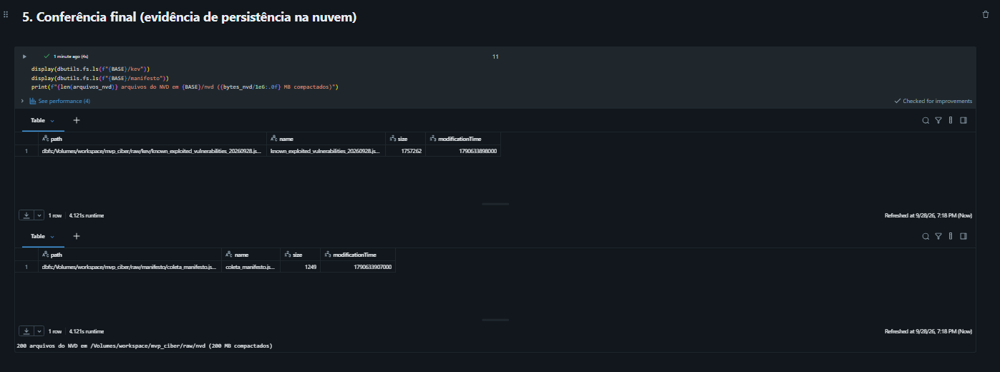 |
| Volume `raw` no Catalog Explorer | 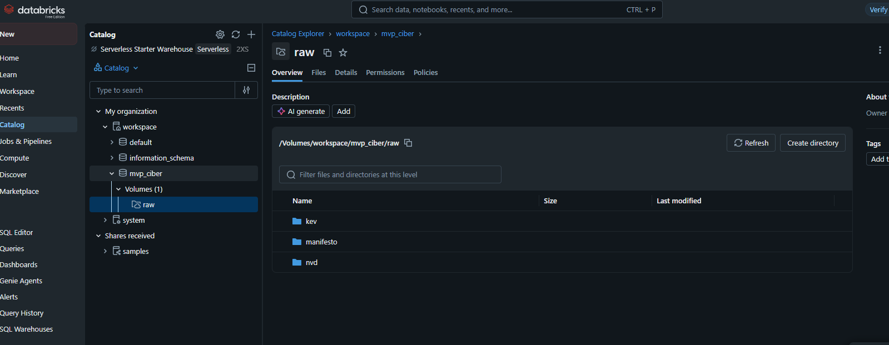 |

### 3.3 Diagnóstico dos dados brutos

Antes da modelagem, o script [`diagnostico_nvd.py`](scripts/diagnostico_nvd.py) percorreu as 200 páginas ([evidência 9](evidencias/09_diagnostico_nvd.png)). Os resultados orientaram as regras de transformação:

| Achado | Quantidade | Consequência para o modelo |
|---|---|---|
| CVEs rejeitadas (`Rejected`) | 18.414 | Excluídas da análise (regra R1) |
| CVEs com CVSS v3.1 / v3.0 / v4.0 / v2.0 | 255.100 / 54.692 / 38.663 / 196.201 | Uma CVE pode ter várias versões. É preciso escolher uma por CVE (R3) |
| CVEs sem nenhuma métrica CVSS | 21.658 | Faixa "Sem CVSS", sem descarte (R3) |
| CVEs sem tipo de falha (CWE) | 25.377 | Complemento pelo KEV quando possível (R5) |
| CVEs marcadas como KEV no próprio NVD | 1.728 | Igual ao total do KEV: cruzamento potencialmente completo |
| CVEs aguardando ou em análise pelo NVD (*Awaiting*, *Received*, *Undergoing*) | 10.354 | Registradas como limitação de atualidade da análise do NVD |

---

## 4. Modelagem

### 4.1 Esquema estrela

O modelo é um **esquema estrela** com uma tabela fato de CVEs. A dimensão de tempo é usada duas vezes, como *role-playing*, para a data de publicação e para a data de inclusão no KEV. A relação N:N entre CVE e tipo de falha é resolvida por uma tabela-ponte.

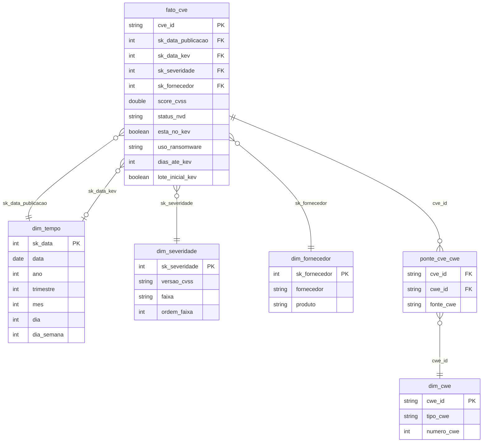

| Tabela | Papel | Grão | Linhas |
|---|---|---|---|
| `fato_cve` | Fato | Uma CVE não rejeitada | 380.419 |
| `dim_tempo` | Dimensão | Um dia (01/01/1988 a 31/12/2026) | 14.245 |
| `dim_severidade` | Dimensão | Uma combinação de versão do CVSS e faixa | 19 |
| `dim_fornecedor` | Dimensão | Um par fornecedor-produto do KEV, mais o membro "Não informado" | 720 |
| `dim_cwe` | Dimensão | Um tipo de falha | 807 |
| `ponte_cve_cwe` | Ponte | Uma associação CVE x CWE | 423.193 |
| `stg_nvd_cve` | Estágio | Uma CVE do NVD, incluindo as rejeitadas | 398.833 |
| `stg_kev` | Estágio | Uma CVE do KEV | 1.728 |

**Por que esse desenho:**
- **Versão e faixa do CVSS juntas na mesma dimensão.** As escalas não são comparáveis: a v2.0 não tem a faixa "Crítica", e uma "Alta" na v2.0 corresponde a parte das "Críticas" na v3.x. Misturá-las distorceria a P1.
- **Fornecedor vem só do KEV.** No NVD, o produto afetado está em configurações CPE complexas, com várias versões e produtos por CVE. Interpretá-las ficou fora do escopo, e a P3 só precisa do fornecedor dentro do KEV.
- **Ponte CVE x CWE.** Uma CVE pode ter mais de um tipo de falha (423.193 associações para 380.419 CVEs).

### 4.2 Catálogo de dados

O catálogo completo, com **48 atributos em 8 tabelas**, está em [`catalogo/catalogo_dados.md`](catalogo/catalogo_dados.md) e [`catalogo/catalogo_dados.csv`](catalogo/catalogo_dados.csv). Para cada atributo, ele registra **nome, tipo, descrição, domínio (faixa ou categorias válidas), obrigatoriedade e linhagem** (campo de origem e regra aplicada). O notebook `02` verifica por código que todo atributo de toda tabela está catalogado e grava a descrição como comentário de coluna no Unity Catalog. Resumo dos atributos da fato:

| Atributo | Tipo | Domínio | Obrigatório | Linhagem |
|---|---|---|---|---|
| `cve_id` | texto | `CVE-AAAA-NNNN...` | Sim | NVD `cve.id` |
| `score_cvss` | numérico | 0,0 a 10,0; nulo se não houver CVSS | Não | NVD `metrics.*.cvssData.baseScore` (R3) |
| `status_nvd` | categórico | Analyzed, Modified, Deferred, Awaiting Analysis, Undergoing Analysis, Received | Sim | NVD `vulnStatus` (R1) |
| `esta_no_kev` | booleano | true, false | Sim | Cruzamento NVD x KEV (R6) |
| `uso_ransomware` | categórico | Conhecido, Desconhecido, Fora do KEV | Sim | KEV `knownRansomwareCampaignUse` (R6, R7) |
| `dias_ate_kev` | numérico | Inteiro, pode ser negativo; nulo fora do KEV | Não | KEV `dateAdded` menos NVD `published` (R9) |
| `lote_inicial_kev` | booleano | true, false | Sim | KEV `dateAdded` = data de criação do catálogo (R10) |

### 4.3 Regras de transformação

| # | Regra | Motivo |
|---|---|---|
| R1 | CVEs `Rejected` ficam no estágio, mas não entram na fato | Uma CVE rejeitada não é uma vulnerabilidade válida |
| R2 | `published` (NVD) e `dateAdded` (KEV) viram `DATE` em UTC | Padroniza as datas das duas fontes |
| R3 | Uma métrica CVSS por CVE, na ordem v3.1 > v3.0 > v4.0 > v2.0. Dentro da versão, prefere-se a fonte *Primary* (o próprio NVD). Sem métrica: faixa "Sem CVSS" | A v3.x é a mais difundida. Escolher uma métrica evita contar a mesma CVE duas vezes |
| R4 | A faixa vem de `baseSeverity`. Se faltar, é derivada do score pela escala da versão. Rótulos em português | Contingência para registros incompletos |
| R5 | CWE extraído do NVD. Quando o NVD não traz nenhum e o KEV traz, usa-se o do KEV. `NVD-CWE-Other` e `NVD-CWE-noinfo` são marcados como genéricos | Aumenta a completude do tipo de falha nas CVEs do KEV |
| R6 | Cruzamento por `cve_id`, partindo do NVD (*left join*). CVE fora do KEV recebe `esta_no_kev = false` e `uso_ransomware = "Fora do KEV"` | O universo é o de todas as CVEs; o KEV é o desfecho |
| R7 | `Known` vira "Conhecido" e `Unknown` vira "Desconhecido" | "Desconhecido" significa sem evidência pública, e não "nunca usado" |
| R8 | Fornecedor e produto vêm do KEV, sem espaços nas pontas. Fora do KEV: chave 0, "Não informado" | Ver seção 4.1 |
| R9 | `dias_ate_kev` = data de inclusão no KEV menos data de publicação. Negativos são mantidos | Um valor negativo indica que a CVE entrou no KEV antes de ser publicada no NVD, o que é um fato legítimo |
| R10 | Inclusões na data de criação do KEV (03/11/2021) recebem `lote_inicial_kev = true` | Esse lote mede o estoque acumulado de falhas antigas, e não o tempo de reação |
| R11 | Duplicatas de `cve_id`: mantém-se o registro com maior `lastModified` | Deduplicação determinística |
| R12 | `sk_data` = AAAAMMDD. As demais chaves substitutas são sequenciais | Padronização de chaves |
| R13 | As tabelas são sobrescritas a cada execução | Idempotência: rodar de novo produz o mesmo resultado |

---

## 5. Carga (ETL)

O notebook [`02_modelagem_carga`](notebooks/02_modelagem_carga.py) implementa o ETL em quatro etapas:

1. **Extração:** lê as 200 páginas do NVD e o JSON do KEV do Volume `raw` e monta as tabelas de estágio.
2. **Transformação:** aplica as regras R1 a R13, monta as dimensões, a ponte e a fato.
3. **Controle de qualidade antes da carga:** dez verificações automáticas, cujo resultado aparece abaixo.
4. **Carga:** grava as 8 tabelas como **Delta** no Unity Catalog (`workspace.mvp_ciber`), com esquema explícito, em modo *overwrite*. Em seguida, valida as contagens e a integridade referencial.

**Controle de qualidade antes da carga** ([evidência 10](evidencias/10_qualidade_antes_da_carga.png)):

| Verificação | Resultado | Esperado |
|---|---|---|
| CVEs únicas na fato | Sim | Sim |
| CVEs do KEV encontradas na fato | 1.728 | 1.728 (total do KEV) |
| CVEs do KEV sem correspondência no NVD | 0 | 0 |
| Chaves de severidade, data de publicação e data do KEV órfãs | 0 | 0 |
| `dias_ate_kev` negativos (mantidos) | 65 | informativo |
| CVEs da fato sem nenhuma métrica CVSS | 3.244 | informativo |
| CVEs da fato sem nenhum CWE | 6.993 | informativo |
| Data de inclusão no KEV igual no KEV e no NVD | 100,0% | ~100% |

**Persistência na nuvem após a carga:**

| | |
|---|---|
| Contagem de linhas das 8 tabelas Delta | 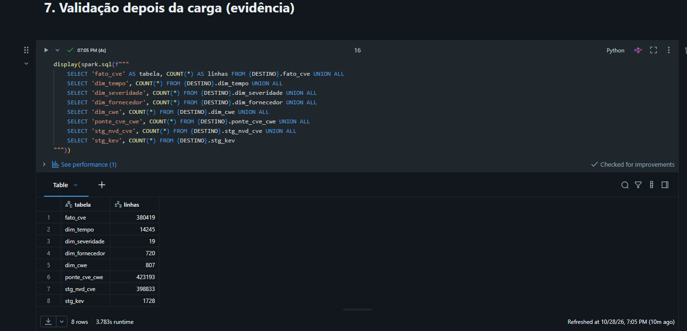 |
| Integridade referencial (todas as contagens iguais a 0) | 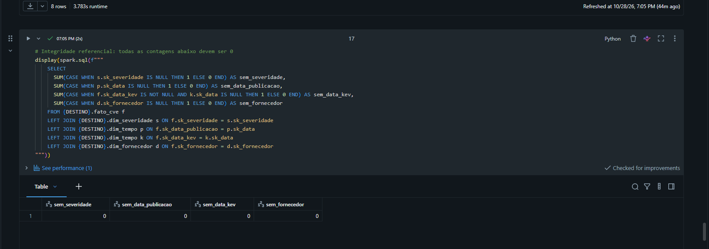 |
| Consulta de exemplo no modelo: CVEs por faixa (v3.1) e quantas estão no KEV | 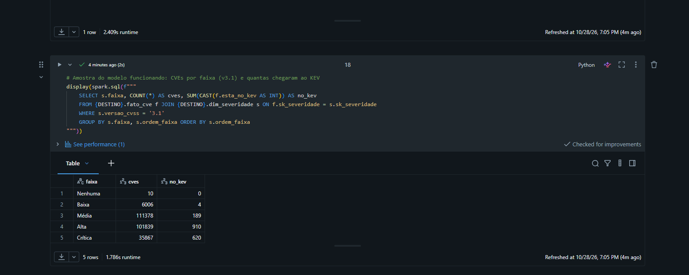 |
| Catálogo de dados gerado no Databricks | 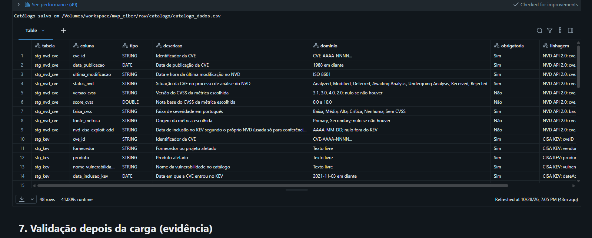 |

---

## 6. Análise

A análise é feita pelo notebook [`03_analise`](notebooks/03_analise.py), que lê as tabelas do modelo e salva as tabelas de resultado (CSV) e os gráficos (PNG) no Volume.

### 6.1 Qualidade dos dados

Perfil de cada atributo usado na análise ([`03_analise`](notebooks/03_analise.py), seção 2). A tabela `fato_cve` aparece junto com os atributos que ela recebe das dimensões. "Fora do domínio" conta os valores não nulos que violam o domínio declarado no [catálogo](catalogo/catalogo_dados.md); "–" indica atributo sem regra de domínio verificável, como texto livre ou booleano.

| Tabela | Atributo | Nulos (%) | Distintos | Mínimo | Máximo | Fora do domínio | Observação |
|---|---|---:|---:|---|---|---:|---|
| fato | `cve_id` | 0 (0%) | 380.419 | | | 0 | Único por CVE |
| fato | `score_cvss` | 3.244 (0,85%) | 94 | 0,0 | 10,0 | 0 | Nulo apenas quando não há CVSS ("Sem CVSS") |
| fato | `status_nvd` | 0 (0%) | 6 | | | 0 | Sem `Rejected` (R1) |
| fato | `esta_no_kev` | 0 (0%) | 2 | | | – | 1.728 verdadeiros |
| fato | `uso_ransomware` | 0 (0%) | 3 | | | 0 | |
| fato | `dias_ate_kev` | 378.691 (99,55%) | 848 | −290 | 7.191 | – | Nulo por definição fora do KEV. Mínimo negativo: ver acurácia |
| fato | `lote_inicial_kev` | 0 (0%) | 2 | | | – | 287 verdadeiros |
| dim_severidade | `versao_cvss` | 0 (0%) | 5 | | | 0 | 3.1, 3.0, 4.0, 2.0, N/A |
| dim_severidade | `faixa` | 0 (0%) | 6 | | | 0 | |
| dim_tempo | `ano_publicacao` | 0 (0%) | 39 | 1988 | 2026 | 0 | |
| dim_tempo | `ano_kev` | 378.691 (99,55%) | 6 | 2021 | 2026 | 0 | Nulo por definição fora do KEV |
| dim_fornecedor | `fornecedor` | 0 (0%) | 284 | | | – | 283 do KEV, mais "Não informado" |
| dim_fornecedor | `produto` | 0 (0%) | 691 | | | – | 690 do KEV, mais "Não informado" |
| stg_kev | `cve_id` | 0 (0%) | 1.728 | | | 0 | Único |
| stg_kev | `fornecedor` | 0 (0%) | 283 | | | 0 | Nenhum vazio |
| stg_kev | `produto` | 0 (0%) | 690 | | | 0 | Nenhum vazio |
| stg_kev | `nome_vulnerabilidade` | 0 (0%) | 1.380 | | | – | Nomes repetidos entre CVEs do mesmo produto |
| stg_kev | `data_inclusao_kev` | 0 (0%) | 477 | 03/11/2021 | 27/09/2026 | 0 | |
| stg_kev | `prazo_correcao` | 0 (0%) | 500 | 17/11/2021 | 30/09/2026 | – | |
| stg_kev | `uso_ransomware` | 0 (0%) | 2 | | | 0 | 361 Conhecido, 1.367 Desconhecido |
| stg_kev | `cwes_kev` | 0 (0%) | 256 | | | – | Texto vazio quando o KEV não informa CWE |

Os nulos de `dias_ate_kev` e `ano_kev` não são falhas: esses atributos só existem para CVEs do KEV. O valor máximo de `dias_ate_kev` (7.191 dias, cerca de 20 anos) corresponde a falhas muito antigas cuja exploração só foi catalogada recentemente.

**Avaliação por dimensão de qualidade:**

| Dimensão | Verificação | Resultado | Tratamento |
|---|---|---|---|
| **Completude** | Nulos por atributo (tabela acima) | `score_cvss` nulo em 3.244 CVEs (0,9%). Nenhuma CVE do KEV está sem CVSS v3.x. 6.993 CVEs (1,8%) estão sem CWE, e 203 das 1.728 do KEV (11,7%) não têm CWE específico | Faixa "Sem CVSS" explícita (R3). As CVEs sem CWE específico ficam fora da comparação de tipos de falha da P3, o que é registrado como limitação |
| **Unicidade** | `cve_id` duplicado | 0 duplicatas: o estágio tem 398.833 linhas, igual ao total informado pela API | Regra R11 ativa como salvaguarda |
| **Consistência** | 4 regras de coerência entre atributos (ex.: `dias_ate_kev` preenchido se e somente se a CVE está no KEV) | 0 violações nas 4 regras. A data de inclusão no KEV coincide 100% entre KEV e NVD | Nenhum necessário |
| **Conformidade** | Valores fora do domínio declarado no catálogo | 0 valores fora do domínio em todos os atributos verificados (tabela acima) | Nenhum necessário |
| **Acurácia** | Valores implausíveis | 65 CVEs do KEV (3,8%) têm `dias_ate_kev` negativo: entraram no KEV antes de serem publicadas no NVD. É plausível (vulnerabilidades exploradas antes da divulgação, ou atraso de publicação no NVD) | Mantidos (R9) e reportados na P2 |
| **Atualidade** | Data da coleta e situação da análise no NVD | Dados de 28/09/2026. 10.354 CVEs ainda aguardavam ou estavam em análise pelo NVD, e 52.132 estão como *Deferred* (sem previsão de análise) | Nessas CVEs, o CVSS pode vir de fonte secundária ou estar ausente. O efeito é pequeno no KEV, onde 100% têm CVSS v3.x |

**Conclusão:** as bases são curadas e consistentes. Os problemas encontrados (ausência de CVSS ou CWE, datas negativas, mistura de versões do CVSS) foram tratados por regras explícitas e não comprometem as respostas. O ponto de maior atenção é que a P1 e a P3 usam apenas CVEs com CVSS v3.x: **298.333 das 380.419 (78,4%)**. As CVEs restantes são majoritariamente antigas, com apenas CVSS v2.0, e nenhuma delas está no KEV.

### 6.2 P1: Que proporção das CVEs chega ao KEV e como ela varia por faixa de severidade?

**Resposta:** **0,45%** das CVEs (1.728 de 380.419) chegam ao KEV. A proporção cresce com a severidade: a faixa Crítica tem uma taxa 10 vezes maior que a Média. Mesmo assim, **só 1,5% das CVEs críticas foram exploradas**, e **64% das exploradas não são críticas**.

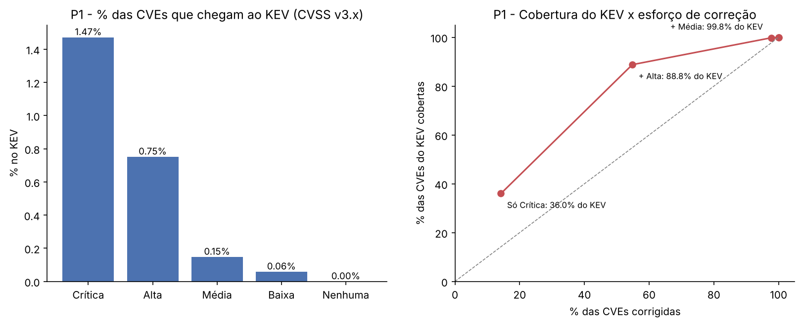

| Faixa (CVSS v3.x) | CVEs | No KEV | % que chega ao KEV | % do KEV | Vezes a média |
|---|---:|---:|---:|---:|---:|
| Crítica | 42.248 | 622 | 1,47% | 36,0% | 2,54 |
| Alta | 121.336 | 913 | 0,75% | 52,8% | 1,30 |
| Média | 127.947 | 189 | 0,15% | 10,9% | 0,26 |
| Baixa | 6.789 | 4 | 0,06% | 0,2% | 0,10 |
| Nenhuma | 13 | 0 | 0,00% | 0,0% | 0,00 |
| **Total** | **298.333** | **1.728** | **0,58%** | **100%** | |

**Cobertura x esforço:** quanto do KEV cada estratégia de priorização por faixa cobre, e com quanto trabalho.

| Estratégia | CVEs a corrigir | % do esforço total | CVEs do KEV cobertas | % do KEV coberto |
|---|---:|---:|---:|---:|
| Só Críticas | 42.248 | 14,2% | 622 | **36,0%** |
| Críticas + Altas | 163.584 | 54,8% | 1.535 | **88,8%** |
| Críticas + Altas + Médias | 291.531 | 97,7% | 1.724 | 99,8% |

**Discussão:**
- **O CVSS tem sinal, mas é impreciso.** A ordem das faixas se confirma: quanto mais grave, maior a chance de exploração. Mas a taxa máxima é de 1,5%. Uma equipe que corrige todas as críticas gasta **98,5% desse esforço em falhas que não constam como exploradas**.
- **A cobertura é ruim exatamente onde o esforço é viável.** Corrigir só as críticas é a estratégia que cabe numa equipe real (14% das CVEs), mas deixa **64% das vulnerabilidades exploradas sem correção**. A faixa **Alta** concentra mais CVEs exploradas (913) do que a Crítica (622). Para chegar a uma cobertura aceitável (89%) é preciso corrigir **mais da metade de todas as CVEs**, o que é inviável na prática.
- **Implicação:** a faixa CVSS funciona como filtro grosseiro (descartar Baixa e Nenhuma custa quase nada em cobertura), mas não como critério de prioridade fina. O próprio KEV é um critério muito mais eficiente: 1.728 CVEs, ou 0,45% do total, com 100% de "precisão" por definição.
- **Ressalva:** o KEV é um **limite inferior** da exploração real, porque inclui apenas casos que a CISA confirmou. Parte das CVEs fora do KEV pode ter sido explorada sem registro. Isso reduz a precisão medida, mas não muda a conclusão sobre cobertura.

### 6.3 P2: Quanto tempo leva para uma CVE entrar no KEV, e esse prazo mudou?

**Resposta:** sem o lote inicial do catálogo, a mediana é de **167 dias**, mas a distribuição é bimodal: 29% das CVEs entram no KEV em até 7 dias e 25% levam mais de 4 anos. O prazo **caiu muito**: desde 2023, a mediana por ano de inclusão fica entre **12 e 26 dias**, e entre as CVEs publicadas em 2025, **64% entraram no KEV em até 30 dias**.

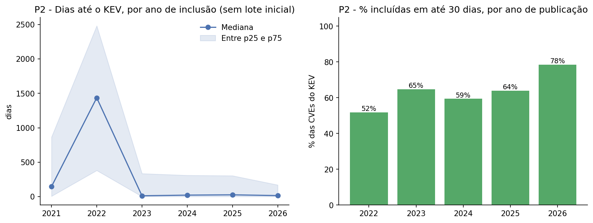

| Grupo | CVEs | Mediana (dias) | p25 | p75 | Até 7 dias | Até 30 dias | Negativos |
|---|---:|---:|---:|---:|---:|---:|---:|
| Todo o KEV | 1.728 | 245 | 8 | 1.364 | 24,4% | 31,8% | 3,8% |
| **Sem o lote inicial** | **1.441** | **167** | 4 | 1.506 | 29,1% | 37,3% | 4,4% |
| Só o lote inicial (03/11/2021) | 287 | 467 | 191 | 772 | 0,7% | 4,2% | 0,7% |

**Por ano de inclusão no KEV** (sem o lote inicial):

| Ano | CVEs | Mediana (dias) | p25 | p75 | Até 30 dias |
|---|---:|---:|---:|---:|---:|
| 2021 | 24 | 146 | 6 | 866 | 33,3% |
| 2022 | 555 | 1.436 | 381 | 2.483 | 12,3% |
| 2023 | 187 | 12 | 1 | 335 | 55,1% |
| 2024 | 186 | 22 | 1 | 310 | 51,1% |
| 2025 | 245 | 26 | 1 | 304 | 51,4% |
| 2026 (até setembro) | 244 | 15 | 1 | 170 | 56,1% |

**Por ano de publicação da CVE** (publicadas a partir de 2022, depois da criação do KEV):

| Ano | CVEs no KEV | Mediana (dias) | p75 | Até 7 dias | Até 30 dias | Negativos |
|---|---:|---:|---:|---:|---:|---:|
| 2022 | 131 | 24 | 167 | 38,9% | 51,9% | 24,4% |
| 2023 | 165 | 6 | 103 | 52,7% | 64,8% | 7,9% |
| 2024 | 160 | 11 | 107 | 48,8% | 59,4% | 4,4% |
| 2025 | 197 | 8 | 55 | 49,2% | 64,0% | 3,6% |
| 2026 | 172 | 4 | 19 | 58,7% | 78,5% | 1,7% |

**Discussão:**
- **A mediana geral esconde dois comportamentos.** O KEV mistura (a) falhas antigas incluídas anos depois da publicação, quando a exploração é confirmada, e (b) falhas novas incluídas em dias. Por isso a mediana geral (167 dias) descreve mal os dois grupos.
- **2022 foi um ano de recuperação de estoque.** No primeiro ano completo do catálogo, a CISA incluiu 555 CVEs com mediana de quase 4 anos (1.436 dias): falhas antigas, já exploradas, que ainda não estavam catalogadas. Depois disso, o padrão muda para inclusões em semanas.
- **A janela de reação é curta e diminuiu.** Para CVEs publicadas desde 2023, metade entra no KEV em 4 a 11 dias (mediana por ano de publicação). Isso tem consequência prática: um ciclo mensal de correções chega tarde para boa parte das vulnerabilidades que serão exploradas.
- **Vulnerabilidades "dia zero":** em 2022, 24% das CVEs do KEV publicadas naquele ano entraram no catálogo **antes** da publicação no NVD. Ou seja, já eram exploradas quando foram divulgadas. A queda dessa proporção nos anos seguintes pode refletir a redução do atraso de publicação do NVD, e não necessariamente menos ataques do tipo.
- **Ressalva de censura:** CVEs publicadas recentemente ainda podem entrar no KEV no futuro, com atraso maior. Isso puxa para baixo as medianas por ano de publicação dos anos mais recentes, principalmente 2026. A tendência de queda é robusta nos anos de 2023 a 2025, mas o valor de 2026 deve ser lido com cautela.

### 6.4 P3: As CVEs ligadas a ransomware têm perfil distinto?

**Resposta:** sim. As **361 CVEs (20,9% do KEV)** com uso conhecido em ransomware são mais frequentemente críticas (**47,9% contra 32,8%**, diferença estatisticamente significativa) e se concentram em **infraestrutura corporativa**: Microsoft, dispositivos de borda de rede (Fortinet, SonicWall, Ivanti), armazenamento (QNAP) e virtualização (VMware). Os tipos de falha mais associados são os que dão acesso remoto sem credenciais. A diferença de severidade, porém, é modesta em termos práticos: as duas medianas são 8,8.

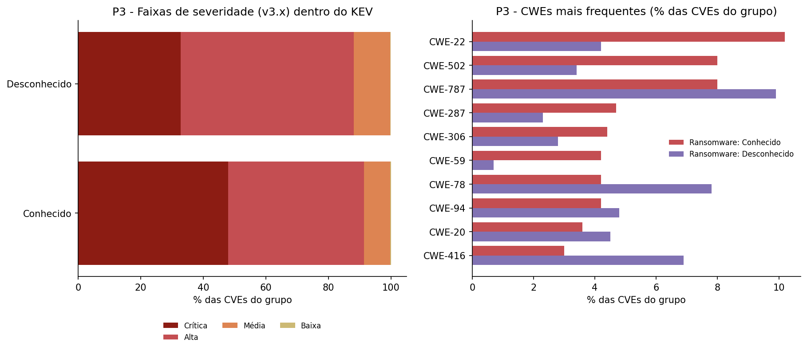

| Atributo | Ransomware: Conhecido | Ransomware: Desconhecido |
|---|---:|---:|
| CVEs (% do KEV) | 361 (20,9%) | 1.367 (79,1%) |
| Score CVSS médio / mediano (v3.x) | 8,60 / 8,8 | 8,37 / 8,8 |
| % Críticas | **47,9%** | 32,8% |
| % Altas | 43,5% | 55,3% |
| % Altas ou Críticas | 91,4% | 88,1% |
| Mediana de dias até o KEV (sem lote inicial) | 150 | 174 |
| Fornecedores distintos | 81 | 257 |
| % das CVEs nos 5 maiores fornecedores | 46,8% | 44,2% |

**Testes estatísticos:**
- Distribuição das faixas: qui-quadrado, p = 2,9 × 10⁻⁶.
- Score CVSS: Mann-Whitney, p = 0,0012.

As duas diferenças são significativas ao nível de 1%.

**Tipos de falha (CWE) com maior diferença** (% das CVEs de cada grupo; uma CVE pode ter mais de um CWE):

| CWE | Tipo de falha | Conhecido | Desconhecido | Diferença (p.p.) |
|---|---|---:|---:|---:|
| CWE-22 | *Path traversal* (acesso a arquivos fora do diretório permitido) | 10,2% | 4,2% | **+6,0** |
| CWE-502 | Desserialização de dados não confiáveis | 8,0% | 3,4% | **+4,6** |
| CWE-59 | Resolução indevida de links (*link following*) | 4,2% | 0,7% | +3,5 |
| CWE-287 | Autenticação inadequada | 4,7% | 2,3% | +2,4 |
| CWE-306 | Ausência de autenticação em função crítica | 4,4% | 2,8% | +1,6 |
| CWE-787 | Escrita fora dos limites da memória | 8,0% | 9,9% | −1,9 |
| CWE-843 | Confusão de tipos (*type confusion*) | 0,6% | 2,9% | −2,3 |
| CWE-78 | Injeção de comandos do sistema operacional | 4,2% | 7,8% | −3,6 |
| CWE-416 | Uso de memória após liberação (*use after free*) | 3,0% | 6,9% | **−3,9** |

**Fornecedores com maior diferença** (% das CVEs de cada grupo):

| Fornecedor | Conhecido | Desconhecido | Diferença (p.p.) |
|---|---:|---:|---:|
| Microsoft | 32,4% | 19,9% | **+12,5** |
| SonicWall | 3,6% | 0,4% | +3,2 |
| Fortinet | 3,9% | 1,2% | +2,7 |
| QNAP | 2,5% | 0,1% | +2,4 |
| Atlassian | 2,2% | 0,4% | +1,8 |
| Ivanti | 3,3% | 1,7% | +1,6 |
| VMware | 2,5% | 1,2% | +1,3 |
| Cisco | 1,9% | 6,7% | −4,8 |
| Google | 0,0% | 5,5% | −5,5 |
| Apple | 0,0% | 6,9% | **−6,9** |

**Discussão:**
- **O que distingue o ransomware é mais o alvo do que a nota.** As duas populações já são de alta severidade (cerca de 90% Altas ou Críticas). A diferença de severidade é real, mas pequena perto da diferença de **fornecedor e classe de falha**.
- **O perfil é coerente com a forma como o ransomware opera:** ele precisa de **acesso inicial** à rede corporativa e de **movimentação lateral**. Por isso, sobressaem falhas exploráveis remotamente e sem credencial (*path traversal*, desserialização, falhas de autenticação) em produtos expostos na borda da rede (VPNs e *firewalls* da Fortinet, SonicWall e Ivanti), em servidores corporativos (Microsoft, Atlassian, VMware) e em armazenamento (QNAP).
- **No grupo "Desconhecido" predominam falhas de corrupção de memória** (*use after free*, *type confusion*) em produtos de usuário final: Apple e Google não têm nenhuma CVE ligada a ransomware no KEV. É uma hipótese compatível com os dados, não testada aqui, que essas falhas estejam mais associadas a ataques direcionados, como espionagem, do que a ransomware.
- **Ressalvas:** (1) "Desconhecido" significa ausência de evidência pública, e a CISA pode atualizar o indicador com o tempo. (2) As tabelas de CWE e de fornecedores comparam muitas categorias sem correção para comparações múltiplas e devem ser lidas como **descritivas**. Os testes formais foram aplicados apenas à severidade. (3) 203 CVEs do KEV sem CWE específico ficam fora da tabela de tipos de falha.

### 6.5 Discussão geral

**A hipótese foi confirmada, com uma nuance.** O CVSS não é inútil: ele ordena corretamente o risco, e as faixas mais altas são exploradas com mais frequência. Mas, como critério **único** de priorização, ele é fraco:

1. **Baixa precisão (P1).** Só 1,5% das críticas são exploradas, então a maior parte do esforço guiado pela nota vai para falhas que não constam como exploradas.
2. **Cobertura ruim no esforço viável (P1).** Corrigir só as críticas deixa 64% das falhas exploradas abertas, e cobrir 89% delas exige corrigir mais da metade de todas as CVEs.
3. **Pouco tempo para reagir (P2).** Metade das CVEs recentes que serão exploradas entra no KEV em até cerca de duas semanas. Uma fila longa, ordenada por nota, não acompanha esse ritmo.
4. **O contexto importa mais do que a nota (P3).** Para a ameaça de ransomware, o fornecedor e a classe da falha (borda de rede, autenticação, acesso remoto) diferenciam mais do que a severidade.

**Recomendação de priorização, em ordem:**
1. Corrigir imediatamente o que está no **KEV**: é um conjunto pequeno (0,45% das CVEs), com exploração comprovada.
2. Em seguida, falhas **Altas e Críticas em ativos expostos** (borda de rede, VPNs, servidores corporativos), sobretudo em classes ligadas a acesso inicial.
3. Por fim, o restante por CVSS, usando a faixa como filtro grosseiro.

**Leitura de Engenharia de Produção:** a curva de cobertura x esforço da P1 é uma curva de Pareto aplicada à alocação de capacidade de manutenção. O ganho está em trocar um critério de ordenação fraco (gravidade potencial) por um sinal de demanda real (exploração observada), como se faz ao priorizar a manutenção pela taxa de falha observada em vez da especificação nominal do equipamento.

---

## 7. Autoavaliação

**1. Quais perguntas foram respondidas e quais não foram? Por quê?**
As três perguntas foram respondidas com dados, evidências e discussão. A P1 e a P2 foram respondidas por completo. A P3 foi respondida para severidade (com teste estatístico), tipo de falha e fornecedor, mas a comparação de fornecedores ficou restrita ao KEV, porque o fornecedor das CVEs fora do KEV não foi modelado (ver item 2). Das cinco perguntas consideradas no início, duas foram retiradas do escopo antes da coleta, para concentrar esforço: (a) se o ranking de CWE das CVEs críticas coincide com o das CVEs do KEV; (b) qual parcela das CVEs de cada fornecedor chega ao KEV. A (a) é viável com o modelo atual, porque a ponte CVE x CWE existe para todas as CVEs. A (b) depende de modelar o fornecedor também no NVD.

**2. Que limitações dos dados condicionaram os resultados?**
- **O KEV é um limite inferior da exploração real** e reflete o foco da CISA (governo dos EUA). A "precisão" medida na P1 é, portanto, conservadora.
- **Fornecedor só no KEV.** No NVD, o produto afetado está em configurações CPE complexas, cuja interpretação ficou fora do escopo.
- **Versões do CVSS não comparáveis.** A P1 e a P3 usam 78,4% das CVEs (as com v3.x). As demais são antigas, com apenas CVSS v2.0, e nenhuma está no KEV.
- **Censura temporal na P2.** CVEs recentes ainda podem entrar no KEV.
- **Indicador de ransomware binário**, sem data, e "Desconhecido" não significa "não usado".
- **Atraso de análise do NVD.** Mais de 62 mil CVEs estavam pendentes ou adiadas (*Deferred*) na data da coleta.

**3. O que faria diferente se recomeçasse?**
- **ETL em Spark nativo.** A transformação foi feita em pandas, no nó de execução, e convertida para Spark na carga. Funcionou para cerca de 400 mil CVEs, mas não escala. Ler os JSON com Spark seria o caminho correto.
- **Chave da API do NVD desde o início**, para reduzir os cerca de 35 minutos de coleta.
- **Execução como Job do Databricks**, em vez de notebook interativo, para não depender da sessão do navegador. Uma suspensão do computador interrompeu a sessão e exigiu rodar o notebook de novo ([evidência 14](evidencias/14_falha_retomada_coleta.png)). Também houve um erro de exibição na tabela de qualidade, que misturava tipos numa mesma coluna ([evidência 15](evidencias/15_erro_display_qualidade.png)) e foi corrigido convertendo os resultados para texto.

**4. Que extensões transformariam o MVP em solução de uso contínuo?**
- **Carga incremental diária**, usando os parâmetros `lastModStartDate` e `lastModEndDate` da API do NVD e a versão do catálogo KEV, agendada como Job.
- **Probabilidade de exploração:** integrar o **EPSS** (*Exploit Prediction Scoring System*, da FIRST), que estima a chance de exploração nos próximos 30 dias, e comparar sua cobertura x esforço com a do CVSS.
- **Contexto do ambiente:** cruzar com o inventário de ativos da organização, para priorizar pelo que está de fato instalado e exposto.
- **Painel** (Databricks AI/BI) com a fila de priorização e os indicadores das três perguntas.
- **Modelar o fornecedor no NVD** (CPE) para responder à pergunta (b) do item 1.

---

## 8. Ética, licenças e proteção de dados

| Tema | Situação |
|---|---|
| **Licença do KEV** | Publicado pela CISA em [cisa.gov/known-exploited-vulnerabilities-catalog](https://www.cisa.gov/known-exploited-vulnerabilities-catalog), com licença própria ([texto](https://www.cisa.gov/sites/default/files/licenses/kev/license.txt)). O espelho oficial mantido pela própria CISA no GitHub ([cisagov/kev-data](https://github.com/cisagov/kev-data)) declara a licença **CC0 1.0** (domínio público), que permite redistribuição e uso derivado |
| **Termos de uso do NVD** | O uso da API segue os [Termos de Uso do NVD](https://nvd.nist.gov/developers/terms-of-use), que pedem o aviso *"This product uses the NVD API but is not endorsed or certified by the NVD"* (presente neste README e nos notebooks) e proíbem sugerir endosso do NVD. A coleta respeitou o limite de requisições públicas |
| **Redistribuição** | Por cautela, **os dados brutos não são versionados neste repositório**. Ele contém apenas o código de coleta, que obtém os dados diretamente das fontes oficiais. Os dados persistem na nuvem (Databricks) |
| **Dados pessoais (LGPD, Lei nº 13.709/2018)** | As bases não contêm dados pessoais. Descrevem vulnerabilidades de software e identificam apenas fornecedores e produtos (pessoas jurídicas) |
| **Dados corporativos** | Não foram usados dados de nenhuma empresa |
| **Código** | Licença MIT ([LICENSE](LICENSE)) |

---

## Referências

- CISA. *Known Exploited Vulnerabilities Catalog*. https://www.cisa.gov/known-exploited-vulnerabilities-catalog
- CISA. *kev-data* (espelho oficial do catálogo KEV). https://github.com/cisagov/kev-data
- NIST. *National Vulnerability Database: Vulnerability API 2.0*. https://nvd.nist.gov/developers/vulnerabilities
- NIST. *NVD API Terms of Use*. https://nvd.nist.gov/developers/terms-of-use
- FIRST. *Common Vulnerability Scoring System (CVSS) v3.1 Specification*. https://www.first.org/cvss/v3.1/specification-document
- MITRE. *Common Weakness Enumeration (CWE)*. https://cwe.mitre.org/
- Databricks. *Databricks Free Edition limitations*. https://docs.databricks.com/aws/en/getting-started/free-edition-limitations
